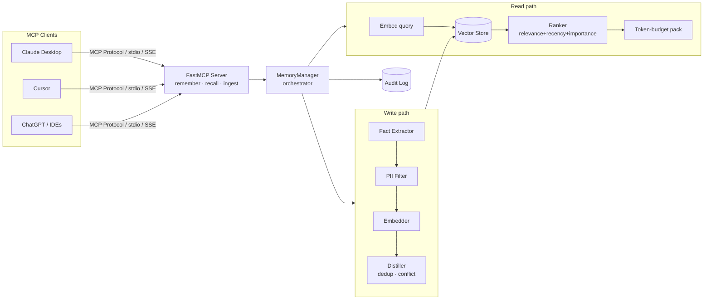

# Memory MCP — Cross-Tool Project Context & Memory Server

**A persistent, shared, _selective_ memory layer for LLM clients (Claude, Cursor, ChatGPT, IDEs), built on the [Model Context Protocol](https://modelcontextprotocol.io).**

LLMs forget everything between sessions and across tools, so developers keep re-explaining their stack, project architecture, workflows, and decisions. Pasting old chats does not scale — it overflows the context window, replays past mistakes, leaks secrets, and goes stale the moment a decision changes.

**Memory MCP** is the **brain on top of storage**: it extracts durable facts from noisy conversations (like architecture, module responsibilities, workflows, decisions, and stack choices), deduplicates them, resolves conflicts as beliefs change, and surfaces only the handful of relevant facts for the current task — to every connected tool, automatically.

> Storing text is the easy 10%. Memory MCP does the hard 90%:
> **extract → dedupe → index → retrieve-the-right-bit → resolve conflicts → expire.**

---

## Why Not Just Paste Chats / Read a Flat File?

| Problem with paste / flat file | What Memory MCP does |
| --- | --- |
| Doesn't scale — which of hundreds of chats has the context? | Semantic **retrieval** surfaces the relevant slice, not the whole history |
| Long pastes overflow the context window ("lost in the middle") | **Token-budgeted** packing returns the top few facts, not 50 pages |
| Raw chat ≠ knowledge (dead ends, corrections) | **Fact extraction & distillation** into clean, self-contained facts |
| One flat file cross-contaminates projects/tools | **Project/tool scoping** with a readable-ancestor hierarchy |
| Contradictions pile up ("React" then "Vue", "AWS" then "GCP") | **Conflict detection** supersedes stale beliefs by canonical key |
| Facts rot; nothing expires | **TTL / staleness** handling keeps memory current |
| Blind pastes leak secrets/PII | **PII-aware filtering** + append-only **audit log** |

---

## Architecture



Every component is designed with a **pluggable interface** and clean offline defaults, so the entire system runs out-of-the-box with zero configuration and zero API keys — then seamlessly upgrades in place when advanced backends are installed.

| Layer | Offline Default | Production Upgrade |
| --- | --- | --- |
| Embeddings | `HashEmbedder` (deterministic, zero-dep) | `sentence-transformers`, OpenAI |
| Vector store | `NumpyVectorStore` (JSON persistence) | ChromaDB |
| Fact extraction | Rule-based patterns + taxonomy | OpenAI / Anthropic LLM |

---

## Quick Start

### 1. Installation
Clone the repository and install dependencies:

```bash
git clone https://github.com/mrunmayeekokitkar/Memory-MCP.git
cd Memory-MCP

# Install core dependencies (lightweight, zero cloud dependencies required)
pip install -r requirements.txt
pip install -e .
```

### 2. Run the Verification Demo
Walk through the entire 6-stage memory pipeline in your terminal:

```bash
python examples/demo.py
```

This demonstrates:
1. **Conversation Ingestion & Distillation**: Parsing multi-turn dialogue into structured facts.
2. **Conflict Resolution**: Changing a belief (e.g., Postgres → MySQL) supersedes old facts automatically.
3. **Hybrid Ranked Recall**: Fetching facts scored by relevance, recency, and importance.
4. **PII Masking**: Automatic redacting of phone numbers, emails, and credentials.
5. **Scope & Project Isolation**: Enforcing boundary checks across different projects.
6. **Immutable Audit Trail**: Chronological event logs for enterprise governance.

### 3. Run the Test Suite
Ensure full test coverage passes locally:

```bash
pytest -q
```

---

## Connecting to MCP Clients

### Running the Server

- **Standard I/O (Default for desktop clients like Claude and Cursor):**
  ```bash
  python -m memmcp.server
  # or via the console script:
  memmcp
  ```

- **SSE Transport (Network / Remote HTTP transport):**
  ```bash
  python -m memmcp.server --transport sse --host 127.0.0.1 --port 8000
  ```

### Claude Desktop Configuration

Add the following to your `claude_desktop_config.json`:
- **macOS:** `~/Library/Application Support/Claude/claude_desktop_config.json`
- **Windows:** `%APPDATA%\Claude\claude_desktop_config.json`

```json
{
  "mcpServers": {
    "memory-mcp": {
      "command": "python",
      "args": ["-m", "memmcp.server"],
      "env": {
        "MEMMCP_DATA_DIR": "./.memmcp_data",
        "MEMMCP_EMBEDDING_PROVIDER": "hash",
        "MEMMCP_VECTOR_BACKEND": "numpy",
        "MEMMCP_EXTRACTION_PROVIDER": "rule",
        "MEMMCP_PII_POLICY": "redact"
      }
    }
  }
}
```

Restart Claude Desktop, and Memory MCP will appear under the hammer / tools icon.

---

## MCP Tools Exposed to LLMs

| Tool | Purpose |
| --- | --- |
| `remember` | Store one durable fact (with project scope, importance, conflict key, TTL) |
| `ingest_conversation` | Distill a raw dialogue into clean, deduplicated facts |
| `ingest_codebase_summary` | Bootstrap memory from a high-level codebase or architecture description |
| `get_project_context` | Retrieve a structured snapshot of the whole project (grouped by category) |
| `recall` | Retrieve top relevant facts for a query, constrained to a token budget |
| `list_memories` | List active (or superseded/expired) memories in a project scope |
| `update_memory` | Edit a memory in place (re-computes embeddings if content changed) |
| `forget` | Soft-delete a memory by unique ID |
| `consolidate` | Cluster and merge near-duplicate facts in a project scope |

Resources exposed:
- `memmcp://stats`: Real-time system statistics and vector index sizes.
- `memmcp://audit`: Tail of the security and mutation audit log.

---

## Semantic Project Knowledge Engine

When configured with an LLM backend (`openai` or `anthropic`), Memory MCP categorizes and indexes project facts into 8 structured categories:

- **Identity**: User, team, and contributor preferences.
- **Stack**: Technology choices (frameworks, runtime versions, databases).
- **Project**: High-level purpose, architecture, and deployment targets.
- **Modules**: Module boundaries, component interfaces, and responsibilities.
- **Workflows**: CI/CD processes, deployment pipelines, testing routines.
- **Decisions**: Architectural Decision Records (ADRs) and design rationales.
- **Domain**: Project-specific vocabulary and business terminology.
- **Status**: Current milestones, active bugs, and technical debt.

---

## Core Engineering & Algorithms

- **Hybrid Ranking**: Blends vector cosine similarity, half-life recency decay ($e^{-\lambda \Delta t}$), and user-assigned importance into a composite score, dynamically packed to fit token budgets.
- **Fact Distillation & Conflict Detection**: Automatically canonicalizes keys (`user:database`, `stack:framework`). When a contradicting assertion arrives, the engine supersedes prior facts while preserving historical audit records.
- **Privacy & Security**: Built-in regex engine with Luhn algorithm validation masks API keys, JWTs, emails, phone numbers, and payment details before data reaches the vector store.
- **Hierarchical Scoping**: Strict project and workspace partitioning prevents context leaks between unrelated projects.

---

## Configuration Reference

Override any setting via `.env` or system environment variables:

| Variable | Default | Description |
| --- | --- | --- |
| `MEMMCP_DATA_DIR` | `./.memmcp_data` | Directory where index and audit logs reside |
| `MEMMCP_EMBEDDING_PROVIDER` | `hash` | `hash` (offline), `sentence-transformers`, or `openai` |
| `MEMMCP_VECTOR_BACKEND` | `numpy` | `numpy` (offline) or `chroma` |
| `MEMMCP_EXTRACTION_PROVIDER` | `rule` | `rule` (offline patterns), `openai`, or `anthropic` |
| `MEMMCP_PII_POLICY` | `redact` | `redact`, `block`, `flag`, or `off` |
| `MEMMCP_WEIGHT_RELEVANCE` | `0.60` | Weight for semantic similarity |
| `MEMMCP_WEIGHT_RECENCY` | `0.25` | Weight for freshness |
| `MEMMCP_WEIGHT_IMPORTANCE` | `0.15` | Weight for caller-assigned importance |
| `MEMMCP_RECENCY_HALFLIFE_DAYS` | `30` | Days until recency score decreases by 50% |

---

## Project Structure

```
Memory-MCP/
├── src/memmcp/
│   ├── server.py            # FastMCP server & tool endpoints
│   ├── memory_manager.py    # Core pipeline orchestrator
│   ├── config.py            # Environment-driven configuration
│   ├── models.py            # Pydantic models & data contracts
│   ├── scoping.py           # Project namespace & isolation logic
│   ├── embeddings/          # Pluggable embeddings (Hash, Local, OpenAI)
│   ├── store/               # Vector stores (Numpy, Chroma)
│   ├── retrieval/           # Ranking & token-budget packing
│   ├── extraction/          # Fact extraction, distillation & conflict judge
│   └── privacy/             # PII detection & append-only audit trail
├── tests/                   # Pytest test suite (87 tests)
├── examples/                # End-to-end demo and client configurations
├── pyproject.toml           # Build system and package metadata
├── requirements.txt         # Core dependencies
└── README.md                # Project documentation
```

---

## Author & Maintainer

- **Author**: Mrunmayee Kokitkar
- **Email**: [mrunmayee.kokitkar@gmail.com](mailto:mrunmayee.kokitkar@gmail.com)
- **Contact**: +91 7588326720
- **GitHub Repository**: [https://github.com/mrunmayeekokitkar/Memory-MCP](https://github.com/mrunmayeekokitkar/Memory-MCP)

---

## License

This project is licensed under the MIT License.
